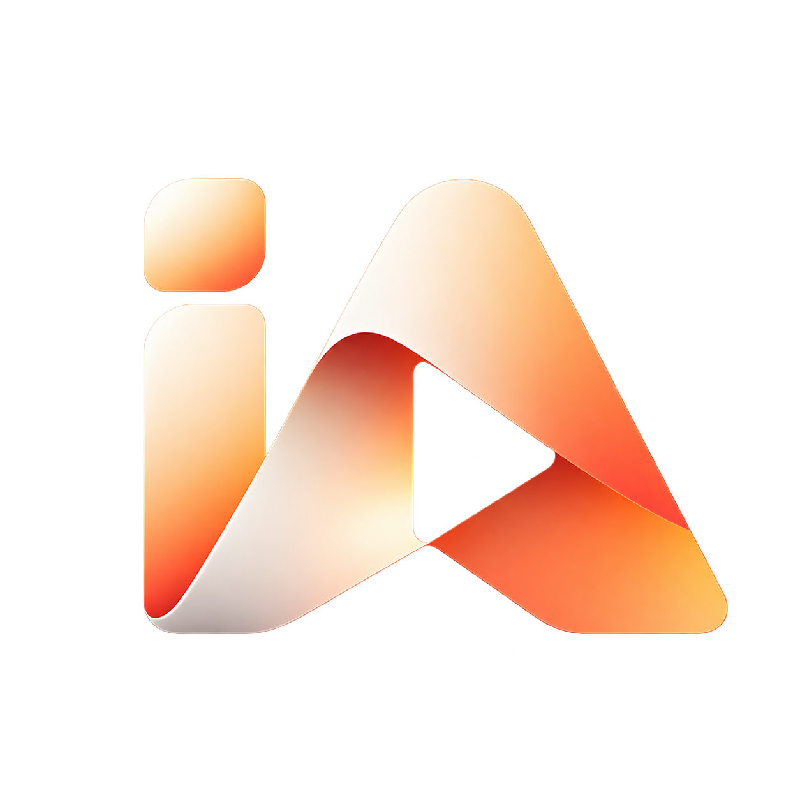
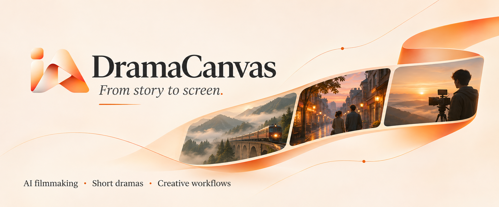

<p align="center"></p>

# DramaCanvas

**Une interface open source pour la création de films avec l’IA, les séries courtes et la narration visuelle.**

[Essayer DramaCanvas](https://dramacanva.com/) · [Intégration API](docs/api.md) · [Périmètre du dépôt](docs/scope.md)

[English](README.md) · [简体中文](README.zh-CN.md) · Français · [日本語](README.ja.md)



DramaCanvas réunit la préparation d’histoires, un canevas infini et des compétences créatives réutilisables dans un même espace de travail. Ce dépôt partage une sélection de pages et de composants du produit pour étudier leur fonctionnement, créer vos propres outils ou connecter votre backend.

**Il s’agit d’un aperçu du frontend, pas du service hébergé complet.** La version locale utilise des données de démonstration isolées. Elle ne fournit ni génération réelle par IA, ni comptes cloud, ni paiements, ni stockage serveur. Le produit complet est accessible sur [dramacanva.com](https://dramacanva.com/).

## À découvrir

| Espace | Contenu disponible |
| --- | --- |
| Accueil | Mise en page, points d’entrée créatifs et exemples fictifs |
| Séries courtes | Navigation des projets et interface de création d’histoires |
| Canevas | Espace visuel, composants de nœuds et code d’édition |
| Compétences | Catalogue multilingue et pages de présentation |
| Modèles vidéo | Navigation et formulaires de paramètres de génération |
| Outils | Boîte à outils, interface de bibliothèque de médias et pages publiques sélectionnées |

Les médias originaux et les projets réels ne sont pas distribués. Certaines pages restent vides en l’absence de données serveur. Product Studio et la page À propos sont exclus de cette version.

## Démarrage rapide

Prérequis : Node.js 22.12+ et Bun 1.3+.

```bash
git clone https://github.com/echoD886/dramacanva.git
cd dramacanva
bun install
bun run dev
```

Ouvrez **http://127.0.0.1:5173**. Aucun compte, aucune clé API et aucun backend ne sont nécessaires.

```bash
bun run build
bun run preview
bun run typecheck
bun run test
bun run audit:public
```

L’aperçu de production est disponible sur **http://127.0.0.1:4173**. Les actions nécessitant un serveur renvoient une erreur explicite ; elles ne simulent pas une génération réussie.

## Connecter votre backend

Les types TypeScript des requêtes et réponses sont inclus. Le [guide d’intégration](docs/api.md) décrit les entrées des projets, compétences, modèles et tâches, ainsi que le transport de démonstration à remplacer.

Conservez les clés des fournisseurs côté serveur. L’authentification, les autorisations, le stockage et l’exécution des tâches restent à implémenter. Cette version ne se connecte pas à l’API du service DramaCanvas.

## Langues et référencement

L’anglais est la langue par défaut. Le README existe aussi en chinois, français et japonais. Le contenu public existant couvre l’anglais, le chinois simplifié et traditionnel, le japonais, le coréen, l’espagnol et le portugais, selon les pages. Ce README français ne signifie pas que toute l’application est traduite en français.

Le code comprend des outils pour les titres, descriptions, URL canoniques, variantes linguistiques et données structurées des compétences, FAQ et procédures. L’aperçu local est en **noindex**. Le prérendu, la soumission des sitemaps et les outils de mesure du site hébergé ne sont pas inclus. Consultez les [notes SEO](docs/seo.md) avant un déploiement.

## Organisation du projet

Les pages se trouvent dans `src/pages/`, les composants partagés dans `src/components/`, le contenu public dans `src/content/` et les traductions dans `src/i18n/`. `src/services/api/` contient les contrats et clients API ; `src/demo/` fournit les données isolées. `public/` contient le logo et l’image de remplacement, et `docs/` les guides d’intégration et de référencement.

Technologies : React, TypeScript, Vite, Ant Design, Tailwind CSS et Zustand.

## Contributions et licence

Les corrections, traductions et améliorations de documentation sont les bienvenues. Indiquez la page, les étapes de reproduction et le résultat attendu. Utilisez des exemples fictifs ; ne publiez ni données de compte, ni prompts privés, ni clés, ni médias personnels. Voir [CONTRIBUTING.md](CONTRIBUTING.md).

Le code est distribué sous [licence MIT](LICENSE). Ce projet s’appuie sur Open AI Canvas et Infinite Canvas ; leurs mentions sont conservées dans [NOTICE](NOTICE). Les dépendances conservent leurs licences. Le nom et le logo DramaCanvas identifient le projet sans cautionner les projets dérivés.
