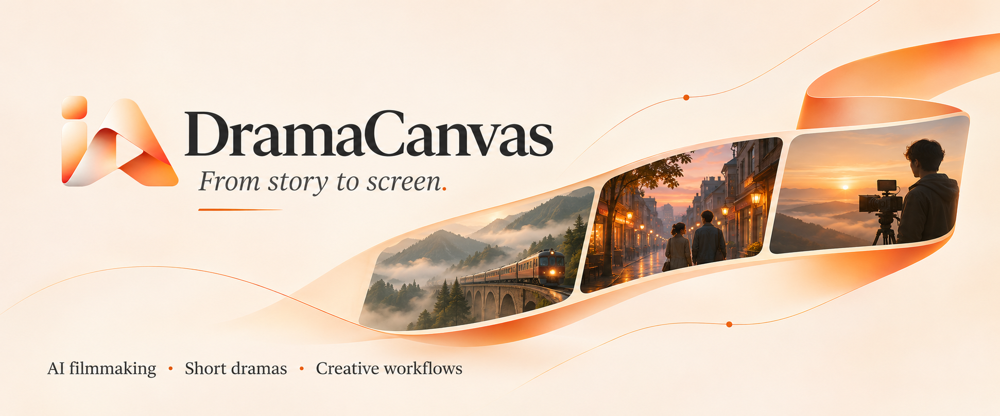
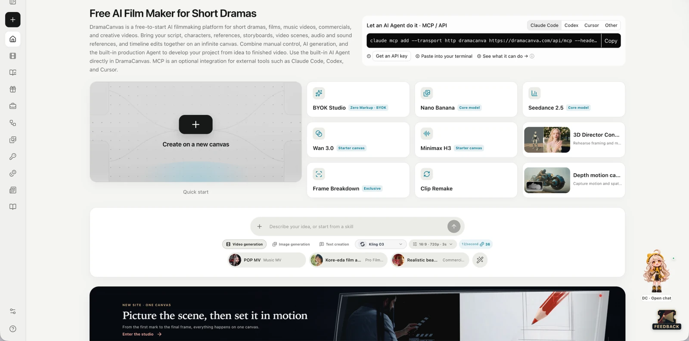
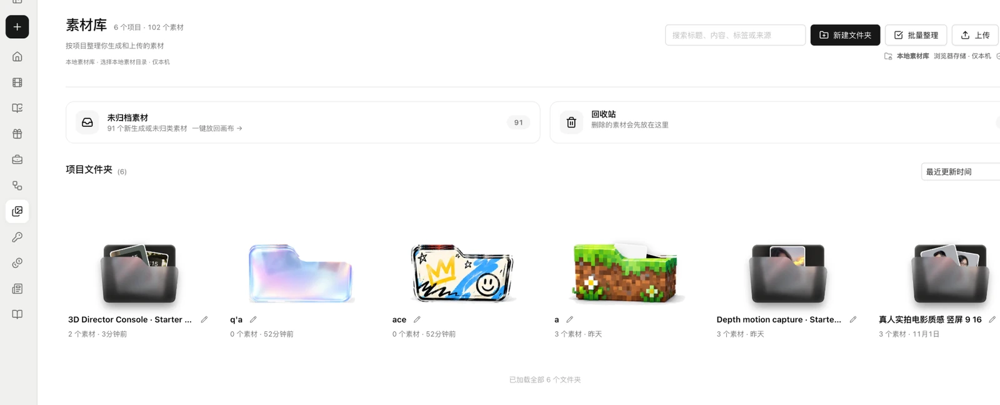

<div align="center">


# DramaCanvas

**An open-source frontend for AI filmmaking, short dramas and visual storytelling.**

[Try it online](https://dramacanva.com/) · [Quick start](#quick-start) · [Connect a backend](#connect-your-own-backend) · [API guide](docs/api.md) · [Release scope](docs/scope.md)

English · [简体中文](README.zh-CN.md) · [Français](README.fr.md) · [日本語](README.ja.md)


</div>



An AI short drama starts with a script, then turns into characters, storyboard shots, prompts, reference images and dozens of generated clips. Once a project has more than a few shots, that material ends up scattered across folders and chat histories.

DramaCanvas keeps it in one place. Guided pages take you from story to storyboard. An infinite canvas holds prompts, character references and generated media side by side, so you can compare and rearrange shots.

This repository contains the frontend: selected pages, components, styles and typed API contracts from the product. Use it to study the interface, reuse the canvas or creation flows in your own tool, or connect your own backend.

> [!NOTE]
> **This is a frontend preview, not the complete hosted service.** It runs on isolated demo data. AI generation, cloud accounts, payments and server-side storage are not included. For the connected workflow, use [dramacanva.com](https://dramacanva.com/).

## Screenshots

These screenshots are from the hosted product. The local preview uses demo data, so lists and libraries start mostly empty.

<p align="center">
  
  <br /><sub><b>Home</b> — start a new canvas, pick a model or tool, or describe an idea and generate a video.</sub>
</p>

<p align="center">
  
  <br /><sub><b>Asset library</b> (Chinese interface) — generated and uploaded media, organized by project.</sub>
</p>

## What's inside

| Area | What you can explore | Source |
| :--- | :--- | :--- |
| **Infinite canvas** | The visual workspace, node components and editing code | [`src/pages/canvas`](src/pages/canvas), [`src/components/canvas`](src/components/canvas) |
| **Short dramas** | Project navigation and the story-to-storyboard interface | [`src/pages/drama`](src/pages/drama) |
| **Home** | The landing page, creation entry points and a fictional showcase | [`src/pages/home`](src/pages/home) |
| **Creative skills** | A multilingual skill directory and detail pages | [`src/pages/skills`](src/pages/skills), [`src/pages/public-skills`](src/pages/public-skills) |
| **Video templates** | Template browsing and generation-input forms | [`src/pages/ai-video-templates`](src/pages/ai-video-templates) |
| **Asset library** | The library interface, toolbox and selected public pages | [`src/pages/assets`](src/pages/assets) |

Original artwork and production project records are replaced or omitted. Empty states are intentional where a page normally receives server data. Product Studio and About are outside this release.

## Quick start

You need Node.js 22.12+ and Bun 1.3+. No account, API key or backend configuration is required.

```bash
git clone https://github.com/echoD886/dramacanva.git
cd dramacanva
bun install
bun run dev
```

Then open **http://127.0.0.1:5173**.

```bash
bun run build          # Build the frontend
bun run preview        # Preview the build at http://127.0.0.1:4173
bun run typecheck      # Type-check the project
bun run test           # Run the tests
bun run audit:public   # Check that the release stays isolated from production
```

The preview does not accept real generation or payment requests. Unsupported actions return a "backend required" error instead of pretending a job finished.

## Connect your own backend

The frontend ships TypeScript request and response types for projects, skills, templates and generation tasks. The [API guide](docs/api.md) describes those inputs, the response envelope, and where to replace the demo transport in [`src/demo/transport.ts`](src/demo/transport.ts).

Replacing the transport is real integration work. Authentication, authorization, storage and task execution are not supplied here, and the public build never talks to the hosted DramaCanvas API. Keep model-provider keys on your server, never in the frontend.

## Languages and SEO

English is the default. This README is also available in Chinese, French and Japanese. The interface text covers English, Simplified Chinese, Traditional Chinese, Japanese, Korean, Spanish and Portuguese, with coverage varying by page. A French README does not mean the app is fully translated into French.

The source includes page-title and description helpers, canonical and language-alternate links, and structured data for skills, FAQs and how-to steps. The local preview is **noindex**, and this release leaves out the hosted site's prerendering, sitemap submission and analytics. Read the [SEO notes](docs/seo.md) before deploying your own version.

## FAQ

### How do I turn a novel or script into an AI short drama?

Start with one scene. Work out its characters, action and dialogue, then plan the shots before you generate anything. DramaCanvas keeps project planning, storyboards and image and video tools in one workspace. The [AI short-drama workflow guide](https://dramacanva.com/blog/ai-short-drama-workflow) walks through the process on the hosted product.

### How can I keep AI characters consistent across shots?

Create character references first and reuse them for every shot. Keep appearance, clothing and scene notes together on the canvas, and check each result before moving on. References guide the model, but consistency still depends on the model and on your choices.

### Can I make an AI video from a single photo?

Yes, on the hosted [AI Video Templates](https://dramacanva.com/ai-video-templates) page. Choose a template, check what it needs and upload a suitable photo. This repository includes the template interfaces, not the generation service or the original template media.

### Is this an open-source AI short-drama generator I can self-host?

You can run and adapt the frontend, but it is not a complete self-hosted generator. Model execution, accounts, billing and cloud storage need your own backend. Follow the [quick start](#quick-start) to explore locally, or [try the hosted product](https://dramacanva.com/) for the full workflow.

### Where can I find React code for an AI storyboard or infinite canvas?

In [`src/pages/canvas`](src/pages/canvas), [`src/components/canvas`](src/components/canvas) and [`src/pages/drama`](src/pages/drama). The [API guide](docs/api.md) explains where the frontend ends and your backend begins.

### Does cloning this repository give me access to private projects or API keys?

No. The release uses fictional showcase records and isolated demo responses. It contains no production account data and no private repository history.

## Project structure

```text
src/pages/        Selected product pages
src/components/   Shared UI and canvas components
src/content/      Public skill content and selected articles
src/i18n/         Interface translations
src/services/api/ Frontend API contracts and clients
src/demo/         Isolated demo transport and example data
public/           Logo and placeholder artwork
docs/             Integration, SEO and release notes
```

Built with React, TypeScript, Vite, Ant Design, Tailwind CSS and Zustand.

## Contributing

Bug reports, clearer documentation and translation fixes are welcome. Include the route, the steps to reproduce and what you expected. Use fictional examples in issues and pull requests, and never attach account exports, private prompts, API keys or personal media. See [CONTRIBUTING.md](CONTRIBUTING.md).

## License

The code is released under the [MIT License](LICENSE), with upstream notices kept in [NOTICE](NOTICE). This frontend builds on Open AI Canvas and Infinite Canvas, and third-party packages keep their own licenses. The DramaCanvas name and logo identify this project and do not imply endorsement of derivative works.
