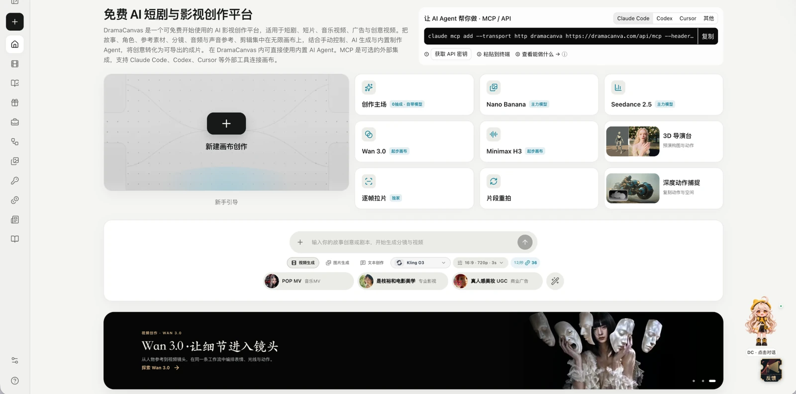
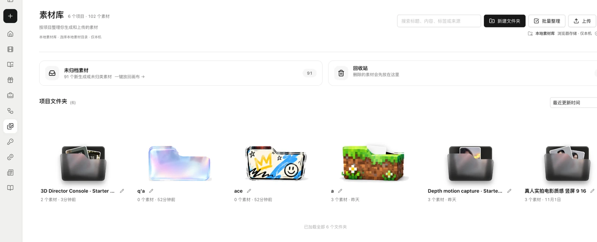

<div align="center">


# DramaCanvas

**面向 AI 影视、短剧与视觉叙事的开源前端。**

[在线体验](https://dramacanva.com/) · [本地运行](#本地运行) · [接入自己的服务](#接入自己的服务) · [接口说明](docs/api.md) · [公开范围](docs/scope.md)

[English](README.md) · 简体中文 · [Français](README.fr.md) · [日本語](README.ja.md)


</div>


做一部 AI 短剧，要从剧本出发，拆出角色、分镜、提示词、参考图，再生成几十段视频。镜头一多，这些素材就散落在各个文件夹和聊天记录里，很难对上号。

DramaCanvas 把它们放进同一个工作台：分步页面带你从故事走到分镜，无限画布把提示词、角色参考和生成结果并排摆开，方便对比和调整镜头顺序。

本仓库公开的是前端部分：产品中的部分页面、组件、样式和带类型的接口定义。你可以拿来研究实现、把画布或创作流程用进自己的工具，或者接上自己的后端。

> [!NOTE]
> **这里是前端预览版，不包含完整线上服务。** 本地运行使用隔离的演示数据，不提供真实 AI 生成、云端账号、支付或服务端存储。完整产品请访问 [dramacanva.com](https://dramacanva.com/)。

## 网站能做什么？

在 [dramacanva.com](https://dramacanva.com/) 上，你可以从故事或剧本开始创建短剧项目，规划角色和分镜，调用 AI 模型生成图片与视频片段，并在无限画布中整理创作素材。技能库和视频模板帮助你复用创作流程，用于短剧、短片、音乐视频等视觉叙事。可用的生成选项取决于所选模型与账号。

**[进入在线创作工作台 →](https://dramacanva.com/)**


## 界面截图

以下截图来自线上产品。本地预览使用演示数据，列表和素材库大多是空的。

<p align="center">
  
  <br /><sub><b>首页</b>：新建画布、选择模型或工具，或者直接输入创意生成视频。</sub>
</p>

<p align="center">
  
  <br /><sub><b>素材库</b>：生成和上传的素材按项目归档。</sub>
</p>

## 包含哪些内容

| 页面 | 可以查看的内容 | 源码位置 |
| :--- | :--- | :--- |
| **无限画布** | 可视化工作区、节点组件与编辑代码 | [`src/pages/canvas`](src/pages/canvas)、[`src/components/canvas`](src/components/canvas) |
| **短剧创作** | 项目导航、从故事到分镜的创作界面 | [`src/pages/drama`](src/pages/drama) |
| **首页** | 页面布局、创作入口与虚构展示案例 | [`src/pages/home`](src/pages/home) |
| **技能库** | 多语言技能目录与详情页 | [`src/pages/skills`](src/pages/skills)、[`src/pages/public-skills`](src/pages/public-skills) |
| **AI 视频模板** | 模板浏览与生成参数界面 | [`src/pages/ai-video-templates`](src/pages/ai-video-templates) |
| **素材库** | 素材库界面、工具箱与部分公开页面 | [`src/pages/assets`](src/pages/assets) |

原始素材、真实作品记录不随代码发布。依赖后端数据的部分页面保留空状态。商品生成和关于我们不在本次公开范围内。

## 本地运行

需要 Node.js 22.12+ 和 Bun 1.3+。

```bash
git clone https://github.com/echoD886/dramacanva.git
cd dramacanva
bun install
bun run dev
```

打开 **http://127.0.0.1:5173**。不需要账号、API Key 或后端配置。

```bash
bun run build
bun run preview
bun run typecheck
bun run test
bun run audit:public
```

构建预览地址为 **http://127.0.0.1:4173**。真实生成、支付等操作会明确提示需要后端，不会伪造生成成功。

## 接入自己的服务

仓库包含前端使用的 TypeScript 请求与响应类型。[接口说明](docs/api.md)介绍项目、技能、模板和生成任务的输入、统一响应格式，以及演示数据适配层的位置。

模型密钥应由你自己的服务端保管。账号鉴权、权限校验、资源存储和任务执行需要另行实现；本仓库不连接 DramaCanvas 的线上业务 API。

## 多语言与 SEO

默认语言为英文，README 提供英文、中文、法语、日语版本。现有公开页面内容涵盖英文、简体与繁体中文、日语、韩语、西班牙语和葡萄牙语，各页面覆盖程度不同；法语 README 不代表应用已完成全部法语翻译。

源码保留页面标题、描述、canonical、语言替代链接，以及技能页的 FAQ、HowTo 等结构化数据辅助代码。本地预览默认禁止索引，不包含线上站点的预渲染、站点地图提交和统计配置。部署自己的版本前，请阅读 [SEO 说明](docs/seo.md)。

## 常见问题

### 怎么把小说或剧本做成 AI 短剧？

建议从一个场景开始，明确角色、动作和对白，再规划分镜并生成素材。DramaCanvas 将项目规划、分镜和图片、视频生成工具放在同一个工作台中。[AI 短剧制作流程指南](https://dramacanva.com/blog/ai-short-drama-workflow)介绍了线上产品的具体流程。

### 多个 AI 镜头怎样保持角色一致？

先确定角色参考图，在后续镜头中复用，并在画布里保留外貌、服装和场景设定。每次生成后检查结果再继续。参考图有助于约束生成方向，但最终一致性仍取决于模型和你的选择。

### 能不能只用一张照片生成 AI 视频？

线上 [AI 视频模板](https://dramacanva.com/ai-video-templates)提供基于照片的视频创作流程。选择模板、检查所需输入，再上传合适的照片。本仓库公开模板界面，不包含实际生成服务和原始模板素材。

### 这是可以直接自部署的完整 AI 短剧生成器吗？

你可以运行和修改前端；完整生成服务还需要接入自己的模型执行、账号、计费和云存储后端。按照上面的本地运行步骤可以查看界面，体验已接好服务的创作流程请访问 [官网](https://dramacanva.com/)。

### 哪里能找到 AI 分镜、无限画布的 React 实现？

可以查看 [`src/pages/canvas`](src/pages/canvas)、[`src/components/canvas`](src/components/canvas) 和 [`src/pages/drama`](src/pages/drama)，其中包含本次公开的画布、节点和故事创作界面。服务接入边界见 [接口说明](docs/api.md)。

### 下载仓库会获得私人项目或 API Key 吗？

不会。公开版使用虚构展示案例和隔离的演示响应，不包含生产账号导出或原私有仓库历史。请使用自己的数据与后端，不要把密钥和私人素材放到公开 Issue 中。

## 目录结构

页面位于 `src/pages/`，共享组件位于 `src/components/`，公开内容和翻译分别位于 `src/content/`、`src/i18n/`。`src/services/api/` 保存前端接口类型与客户端，`src/demo/` 提供隔离的演示数据；`public/` 包含 Logo 和占位图，`docs/` 包含接入与 SEO 说明。

技术栈：React、TypeScript、Vite、Ant Design、Tailwind CSS、Zustand。

## 参与贡献

欢迎报告问题、改进文档和完善翻译。请说明页面路径、复现步骤和预期行为，并使用虚构案例。不要在 Issue 或 PR 中上传账号导出、私人提示词、密钥或个人素材。详见 [贡献说明](CONTRIBUTING.md)。

代码采用 [MIT 许可证](LICENSE)。项目基于 Open AI Canvas 与 Infinite Canvas，原有署名保留于 [NOTICE](NOTICE)。第三方依赖遵循各自许可证；DramaCanvas 名称与 Logo 用于识别本项目，不表示对衍生项目的背书。
